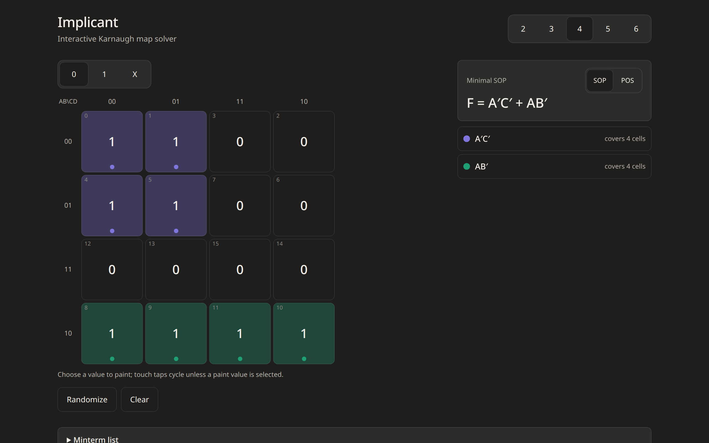
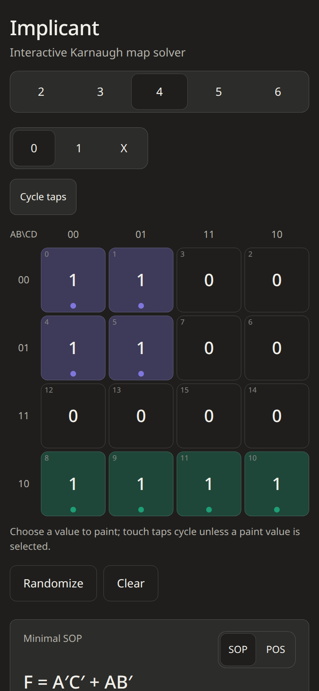
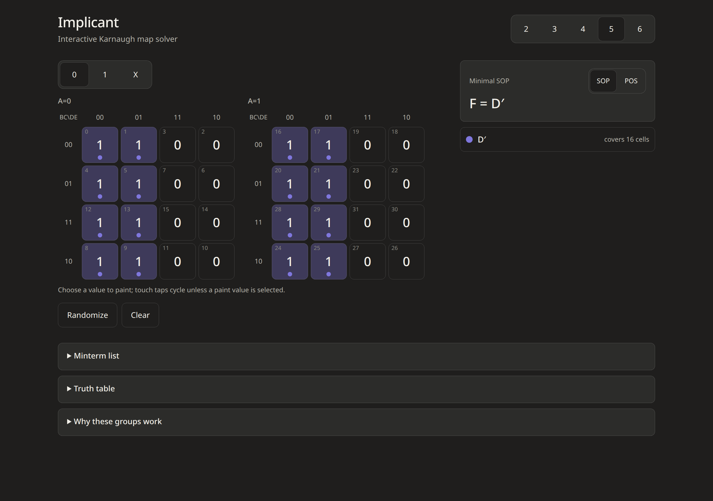
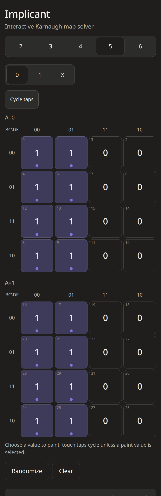
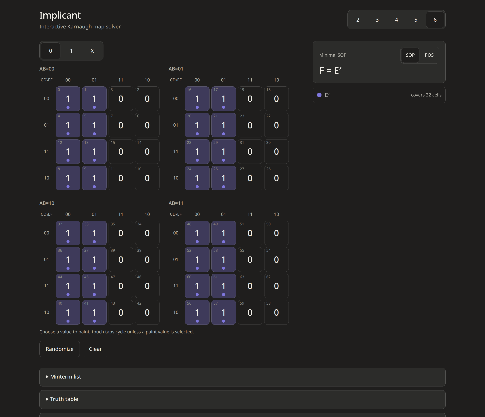
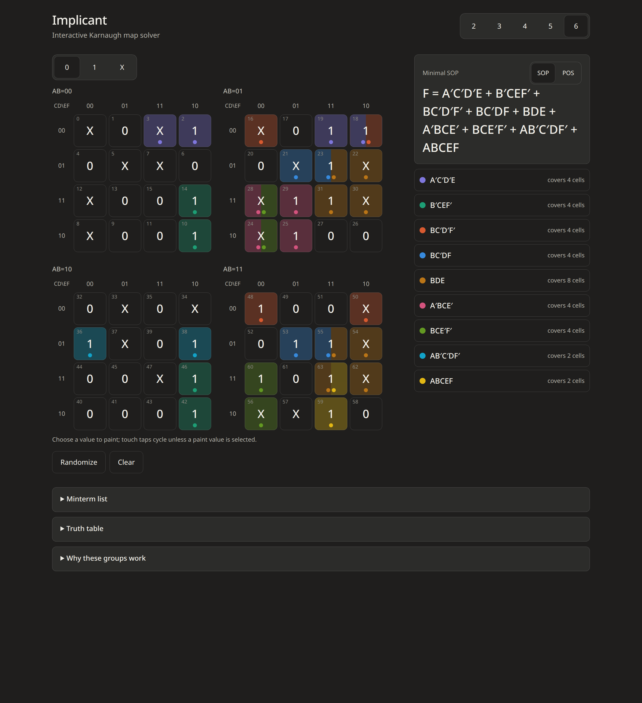

# Implicant

[](https://github.com/DanielMellen-University/Implicant/actions/workflows/ci.yml)
[](LICENSE)

**A touch-friendly Karnaugh map solver in the browser.**

Paint cells as 0, 1, or X, and Implicant updates a minimal sum of products as you go. It also has a product-of-sums mode, a synchronized truth table, and a short explanation of why each group drops a variable. Everything runs in the page, with no build step.

Live demo: [danielmellen-university.github.io/Implicant](https://danielmellen-university.github.io/Implicant/)



## Features

- Maps for 2 through 6 variables, including two-layer 5-variable maps and four-layer 6-variable maps
- A 0 / 1 / X paint selector, with tap-to-cycle on touch screens
- Live minimal SOP or POS, with a unique color for every group
- Slate 0s, teal 1s, and amber Xs, with split color strips for overlapping groups
- A legend that outlines a group's cells, a minterm list, a truth table synced both ways with the map, and per-group explanations
- Randomize (each cell independently 0, 1, or X) and Clear
- A shareable URL that restores the current map
- A dark theme, laid out for phones and desktops

## Quick start

Open the [live demo](https://danielmellen-university.github.io/Implicant/). From a checkout, serve the files and open the page:

```
python3 -m http.server
```

Then visit `http://127.0.0.1:8000/`. Any static file server works. The app is `index.html`, `styles.css`, `ui.js`, `solver.js`, and `helpers.js`.

## How it works

```
cells ──► Quine–McCluskey primes ──► essential primes
                                      │
                                      ▼
                           exact minimum cover (fewest
                           terms, then fewest literals)
                                      │
                                      ▼
                           SOP or POS, group colors,
                           explanations, and the minterm list
```

1. Quine–McCluskey finds the prime implicants. Don't-care cells can enlarge a group, but a group is never required to cover an X.
2. Essential primes are taken first. If a cyclic chart remains, an exact search picks a cheapest cover: fewest terms, then fewest literals. Ties are broken deterministically.
3. SOP groups the 1s. POS groups the 0s. The minterm list always describes the input ones, including any `d(...)` terms.

The solver is a plain ES module with no DOM, so the same code can be unit-tested in Node and run in the page.

## Screenshots

| | |
| --- | --- |
|  Four-variable map on a desktop. |  The same map on a phone. |
|  Five-variable layers, side by side, each labeled A=0 or A=1. |  The same layers stacked on a phone. |
|  Six-variable layers in a 2×2 Gray-code arrangement. |  Earlier six-variable view showing overlapping groups. |

## Project layout

```
index.html      app shell
styles.css      dark theme and layout
ui.js           map rendering, paint mode, extras, and URL state
solver.js       Gray layouts, Quine–McCluskey, exact cover, formatting
helpers.js      group colors and the random-fill helper
tests/          Node test suite (`node --test`, no extra dependencies)
docs/SPEC.md    design notes
docs/screenshots/
.github/workflows/ci.yml      unit tests
.github/workflows/pages.yml   deploy the app to GitHub Pages
```

## Limitations

These are deliberate scope choices.

- **Only 2 through 6 variables.** That is the usual Karnaugh-map range, and it keeps the exact cover search interactive at 64 cells.
- **One minimal cover, not every minimal cover.** If two covers have the same number of terms and literals, the solver returns one of them and ignores the rest.
- **SOP and POS only.** The solver does not search mixed forms or multi-output functions.
- **Dark theme only.** There is no light palette.

## Testing

```
node --test
```

The suite checks Gray-code layouts and adjacency, Quine–McCluskey and exact covers (including an exhaustive 2- and 3-variable check), POS, group explanations, unique group colors, and the random-fill helper. CI runs the same command on every push and pull request.

## License

MIT. See [LICENSE](LICENSE).
