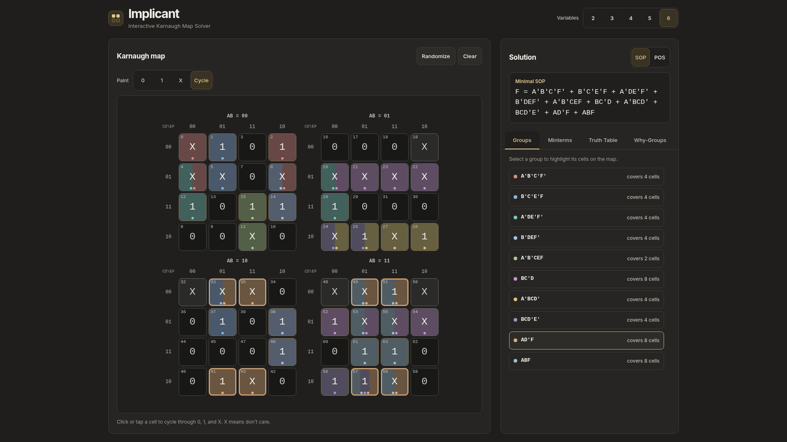

<h1 align="center"></h1>

<p align="center">
  <a href="https://github.com/DanielMellen-University/Implicant/actions/workflows/ci.yml"></a>
  <a href="docs/SPEC.md"></a>
  <a href="#run-locally"></a>
  <a href="LICENSE"></a>
</p>

<p align="center">
  <a href="https://danielmellen-university.github.io/Implicant/"><strong>Live Demo</strong></a> ·
  <a href="docs/GUIDE.md">User Guide</a> ·
  <a href="docs/SPEC.md">How It Works</a> ·
  <a href="https://github.com/DanielMellen-University/Implicant/releases">Releases</a>
</p>

Implicant simplifies Boolean functions with two to six variables. Edit the Karnaugh map or truth table to see the minimal sum of products (SOP) or product of sums (POS), then select a group to see which cells it covers.

[](https://danielmellen-university.github.io/Implicant/)

## Try it

1. Open [Live Demo](https://danielmellen-university.github.io/Implicant/) and choose **0**, **1**, **X** (don't care), or **Cycle**.
2. Edit a cell. The expression, minterms, and truth table update from the same input.
3. Select a term under **Groups** to highlight its cells. Open **Why-Groups** to see which variables stay fixed and which drop out.

The address bar holds the current map and expression form. Copy the URL to share a reproducible example.

## How it works

The browser sends the map's values to a standalone JavaScript solver. Quine-McCluskey finds the largest legal groups, then an exact cover search minimizes the number of terms first and the total number of literals second. The UI uses that same result for the expression, cell highlights, and explanations. See the [solver walkthrough](docs/SPEC.md) for a worked example, the cover search, and the test strategy.

## Run locally

Serve the repository root with Python 3, then open `http://127.0.0.1:8000/`. The app uses native ES modules and runs with no build step or runtime packages.

```sh
python3 -m http.server 8000 --bind 127.0.0.1
```

Run the solver tests with Node.js 22 or newer. The browser suite also uses Python 3 to serve the app locally.

```sh
npm test
npm ci
npx playwright install --only-shell chromium
npm run test:browser
```

GitHub Actions runs both suites on pushes and pull requests. The unit tests compare every two- and three-variable input against an independent solver. The Chromium suite runs on desktop and emulated mobile and checks map edits, URL restoration, group selection, and long expressions.

## License

[MIT](LICENSE)
