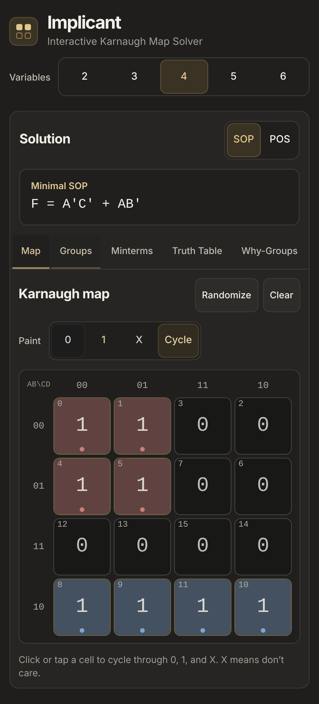

# User Guide

[Live Demo](https://danielmellen-university.github.io/Implicant/) · [Repository overview](../README.md) · [How It Works](SPEC.md)

## Read the map

Each cell is one input combination. Its small number is the minterm index, and its large symbol is the output. For four variables, the row gives `AB` and the column gives `CD`. Both axes use Gray-code order, so consecutive labels differ by one bit, including at the wraparound edges.

Five variables add two layers. Six variables add four. Two cells in neighboring layers can be grouped when their row and column match and the layer labels differ by one bit.

## Edit a function

| Control | Action |
| --- | --- |
| **Variables** | Choose two through six variables. Changing the count starts a cleared map. |
| **0**, **1**, **X** | Set the output to a fixed value. Click or tap a cell. With a mouse, drag to paint multiple cells. |
| **Cycle** | Step through `0 → 1 → X → 0` with each click, tap, or keyboard activation. |
| **Randomize** / **Clear** | Fill each cell independently with an equally likely value, or set every cell to `0`. |
| **Truth Table** | Select a value and click or tap an output in the `F out` column. The matching map cell updates. |

`X` means the output can be either zero or one for that input. The solver can include an X to make a larger group and simplify the expression.

## Inspect the result

- **SOP** covers the ones with product terms and joins the terms with OR. **POS** covers the zeros with sum clauses and joins the clauses with AND.
- **Groups** highlights one term across every layer it covers. Select the same group again to clear the highlight. Split fills and matching dots identify overlapping groups.
- **Minterms** lists the input indices with output one as `Σm(...)` and lists don't-cares separately as `d(...)`. The list stays the same when you switch between SOP and POS.
- **Why-Groups** shows the fixed variables for the selected group and explains which variables can drop out. With no group selected, it lists the explanations for the full solution.

On a phone, use the view bar to switch between **Map**, **Groups**, **Minterms**, **Truth Table**, and **Why-Groups**. Selecting a group returns you to the highlighted map.

## Share an example

Copy the page URL after editing to preserve the variable count, cell outputs, and SOP or POS mode. This [four-variable example](https://danielmellen-university.github.io/Implicant/?v=4&cells=1100110011110000&form=SOP) opens with the expression `F = A′C′ + AB′`.
